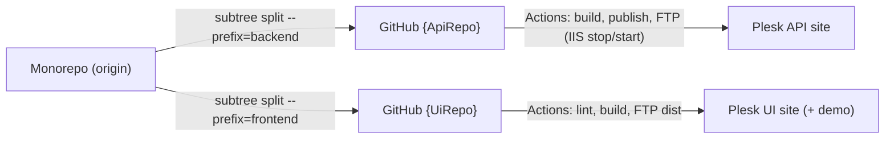

# CI/CD setup — what to replace to make deploy work

Same model as the School Suite (`suite-api-deploy.mdc`, `suite-ui-deploy.mdc`, `git-push-confirm.mdc`,
`backend/DEPLOY.md`):

- You develop in **one monorepo** (`origin`) with `backend/` and `frontend/`.
- Production CD runs on **two separate GitHub repos**, fed by `git subtree` pushes:
  `backend/` → **{ApiRepo}**, `frontend/` → **{UiRepo}**.
- Each deploy repo has its own `.github/workflows/deploy.yml` (stored inside `backend/` and `frontend/`
  so it lands at the repo root after the subtree split).
- Hosting: **Plesk on Windows/IIS**, upload over **FTP**. `git push origin` alone deploys nothing.



Reference files: `reference/backend/.github/workflows/deploy.yml`, `reference/backend/scripts/*`,
`reference/backend/DEPLOY.md`, `reference/frontend/.github/workflows/deploy.yml`.

---

## 1. Replace table

| What | Where | Original value | Replace with |
|---|---|---|---|
| API deploy repo | GitHub | `jazib-geek/SoftelligentSchoolSuitePro-API` | `{GitHubOwner}/{ApiRepo}` |
| UI deploy repo | GitHub | `jazib-geek/SoftelligentSchoolSuitePro-UI` | `{GitHubOwner}/{UiRepo}` |
| Git remote names | local repo | `suite-api`, `suite-ui` | keep the names (scripts/rules use them) **or** rename everywhere: `Push-SuiteDeploy.ps1`, `rules/*deploy*.mdc`, `DEPLOY.md` |
| Actions URLs | `Push-SuiteDeploy.ps1`, `DEPLOY.md`, rules | `https://github.com/jazib-geek/SoftelligentSchoolSuitePro-*/actions` | `https://github.com/{GitHubOwner}/{ApiRepo}/actions`, `…/{UiRepo}/actions` |
| API project path | `backend/.github/workflows/deploy.yml` → `env.API_PROJECT` | `School.API/School.API.csproj` | `{Product}.API/{Product}.API.csproj` |
| Publish DLL checks | same file, "Verify publish output" step | `School.API.dll`, `School.Application.dll`, `School.Infrastructure.dll`, `School.*.dll` | `{Product}.API.dll`, `{Product}.Application.dll`, `{Product}.Infrastructure.dll`, `{Product}.*.dll` |
| .NET version | `env.DOTNET_VERSION` | `8.0.x` | keep unless target framework changes |
| Node version | UI workflow `setup-node` | `22` + `npm install -g npm@11.6.2` | keep; the npm pin must match the npm that wrote `package-lock.json` |
| Workflow header comments | both workflows | mention `sciencebaseschool.com`, School suite | your domains / product |
| Subtree prefixes | `Push-SuiteDeploy.ps1` | `backend`, `frontend` | keep (folder layout is identical) |
| Split branch names | `Push-SuiteDeploy.ps1` | `api-release-push`, `frontend-ui-release` | keep |
| Production API URL | `frontend/.env.production` | `VITE_API_BASE_URL=https://<school api>` | `https://api.<your-domain>` |
| Demo API URL | `frontend/.env.demo`, `.env.demo.production` | demo URL | yours (or delete demo build + step) |
| CORS | server `appsettings.json` → `Cors:AllowedOrigins` | school UI origins | `https://<ui-domain>`, `https://demo.<ui-domain>` |
| JWT issuer/audience/key | server `appsettings.json` | School values | new random key ≥ 32 chars, `{Product}.API` / `{Product}.Web` |
| Tenants | server `appsettings.json` → `TenantSettings` | `CampusSettings` | your tenant keys, names, connection strings |

---

## 2. GitHub secrets (names only — never commit values)

### {ApiRepo}

| Secret | Required | Value |
|---|---|---|
| `FTP_SERVER` | yes | FTP **hostname only** (e.g. `myhostingserver.com`) |
| `FTP_USERNAME` | yes | **site-scoped** FTP user whose home folder **is** the API site root |
| `FTP_PASSWORD` | yes | |
| `FTP_PROTOCOL` | no | `ftp` (default) or `ftps` |

Do **not** add `FTP_REMOTE_DIR` / `FTP_API_REMOTE_DIR` for the API: upload goes to the FTP login root, no
`cd` (old values caused `550` errors). Don't reintroduce path `cd` in the scripts.

### {UiRepo}

| Secret | Required | Value |
|---|---|---|
| `FTP_SERVER` | yes | FTP hostname |
| `FTP_USERNAME` | yes | |
| `FTP_PASSWORD` | yes | |
| `FTP_PROTOCOL` | no | `ftp` / `ftps` |
| `FTP_REMOTE_DIR` | yes | production site folder, e.g. `/httpdocs/` |
| `FTP_REMOTE_DIR_DEMO` | no | demo folder, e.g. `/demo.<domain>/`; unset = demo deploy skipped |

---

## 3. One-time setup steps

1. **Create GitHub repos** `{ApiRepo}` and `{UiRepo}` (empty, private).
2. **Add remotes** in the monorepo:
   ```powershell
   git remote add suite-api https://github.com/{GitHubOwner}/{ApiRepo}.git
   git remote add suite-ui  https://github.com/{GitHubOwner}/{UiRepo}.git
   ```
3. **Copy workflow + scripts** (from `reference/`), applying the replace table:
   - `backend/.github/workflows/deploy.yml`
   - `backend/scripts/ci-deploy-api-ftp.sh`, `backend/scripts/ci-restore-api-ftp.sh` (keep LF line endings;
     add `*.sh text eol=lf` to `.gitattributes`; `git update-index --chmod=+x` both)
   - `backend/scripts/Push-SuiteDeploy.ps1`
   - `backend/DEPLOY.md`
   - `frontend/.github/workflows/deploy.yml`
4. **Add secrets** (§2) on each deploy repo.
5. **Plesk API site**:
   - ASP.NET Core Hosting Bundle (.NET 8) installed; app pool **No Managed Code**.
   - Place `web.config` in the site root (what `dotnet publish` generates; `aspNetCore processPath="dotnet"
     arguments=".\{Product}.API.dll" hostingModel="inprocess"`). The deploy script renames it to `web1.config`
     to stop IIS while uploading and renames it back afterwards — **it must exist on the server**, and the
     mirror excludes it so your server copy (env vars, stdout logging) is never overwritten.
   - Upload the **production `appsettings.json`** manually once (FTP mirror excludes `appsettings*.json` —
     it is never overwritten by deploys). On boot the API throws if `TenantSettings:Tenants` is empty.
   - Set `Database:MigrateOnStartup: true` on the server **or** run `{Product}.Migrator` against production
     connection strings from a trusted machine.
6. **Plesk UI site**: static hosting of `dist/`. Because routing uses `HashRouter`, no rewrite rules are needed.
7. **First deploy** (from monorepo root, after committing):
   ```powershell
   cd frontend; npm run lint; cd ..          # 0 errors required (CI runs lint before build)
   git push origin master
   .\backend\scripts\Push-SuiteDeploy.ps1 -Api -Ui
   ```
8. **Verify** both Actions runs: **build** then **deploy** green; smoke-test login.

---

## 4. `Push-SuiteDeploy.ps1` (template)

```powershell
# Push backend/ and/or frontend/ subtrees to the deploy-only repos (CD runs there).
[CmdletBinding()]
param(
    [switch] $Api,
    [switch] $Ui
)
$ErrorActionPreference = 'Stop'
Set-Location (Resolve-Path (Join-Path $PSScriptRoot '..\..'))

if (-not $Api -and -not $Ui) {
    Write-Host 'Usage: .\backend\scripts\Push-SuiteDeploy.ps1 -Api | -Ui | -Api -Ui'
    exit 1
}
if ($Api) {
    git subtree split --prefix=backend -b api-release-push | Out-Null
    git push suite-api api-release-push:master
    Write-Host "API push done. Verify: https://github.com/{GitHubOwner}/{ApiRepo}/actions"
}
if ($Ui) {
    git subtree split --prefix=frontend -b frontend-ui-release | Out-Null
    git push suite-ui frontend-ui-release:master
    Write-Host "UI push done. Verify: https://github.com/{GitHubOwner}/{UiRepo}/actions"
}
```

(Compare with `reference/backend/scripts/Push-SuiteDeploy.ps1` and keep any extra safety checks it has.)

---

## 5. How the API deploy works (don't regress)

1. Build job: `restore` → `build -c Release` → `publish` (verifies compile on PRs too).
2. Deploy job (push to `master`/`main` only): publish → verify DLLs → verify scripts (`bash -n`, shebang) →
   install `lftp` →
   `ci-deploy-api-ftp.sh`: upload `app_offline.htm` → wait 25 s → rename `web.config` → `web1.config`
   (retry 12×) → wait → `lftp mirror -R --parallel=1 --no-perms` excluding `appsettings.json`,
   `appsettings.*.json`, `web.config` (retry 6×).
3. `ci-restore-api-ftp.sh` runs with `if: always()`: remove `app_offline.htm`, rename `web1.config` →
   `web.config`.

`--no-perms` is required (Windows IIS FTP rejects `SITE CHMOD`). If deploy fails with **550 / file in use**,
check the Stop/Start steps and make sure the server has `web.config` (not only `web1.config`) and no stray
`app_offline.htm`.

## 6. How the UI deploy works

Build job: `npm ci` → **`npm run lint`** (errors fail CI, warnings don't) → `npm run build` →
`npm run build:demo`. Deploy job: production build → `SamKirkland/FTP-Deploy-Action@v4.3.6` to
`FTP_REMOTE_DIR` (`dangerous-clean-slate: false`) → optional demo build/upload to `FTP_REMOTE_DIR_DEMO`.

---

## 7. Agent rules for releases (copy from `rules/`)

- A user request to **check in / push / deploy** is the confirmation. Commit **all** uncommitted changes
  under `backend/` and `frontend/` (unless the user limits scope), run `npm run lint` in `frontend/` and fix
  errors, `git push origin master` if ahead, then `.\backend\scripts\Push-SuiteDeploy.ps1 -Api -Ui`
  (only one side if the user names just API or UI).
- Never push when the user didn't ask.
- "Everything up-to-date" on a subtree push means **no new Actions run**.
- Never commit FTP credentials, connection strings, JWT keys, or production `appsettings.json`.
