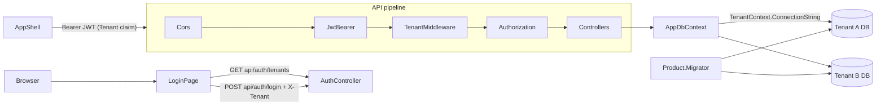

# Project Blueprint — Multi-tenant Suite (Backend + Frontend)

This folder is a **build specification** for creating a new product from scratch that reuses the exact
backbone of the School Suite: multi-tenant ASP.NET Core API (one SQL Server database per tenant),
single JWT login, permission-based UI, campus-style shell (top bar + sidebar), theme presets,
user-to-user chat, scalable activity logs, and GitHub Actions FTP deploy to Plesk.

It is written for an **AI coding agent**. Follow it literally. When this document and a file under
`reference/` disagree, **this document wins** — `reference/` is the original (domain-heavy) code kept
only so you can copy UI markup, styling, and proven patterns.

---

## 0. Placeholders

Replace these tokens everywhere (folder names, namespaces, csproj names, configs, docs):

| Token | Meaning | Example |
|---|---|---|
| `{Product}` | PascalCase product / namespace root | `Clinic` → `Clinic.API` |
| `{product}` | kebab/lower product id | `clinic` |
| `{ProductTitle}` | Display name in UI | `Clinic Suite` |
| `{TenantLabel}` | What a tenant is called in UI | `Branch`, `Campus`, `Company` |
| `{GitHubOwner}` | GitHub account/org | `jazib-geek` |
| `{ApiRepo}` / `{UiRepo}` | Deploy-only repos | `ClinicSuite-API` / `ClinicSuite-UI` |

---

## 1. Read order

> Starting a new build from an empty root? Paste the prompt in [`AGENT-PROMPT.md`](AGENT-PROMPT.md)
> into a new agent chat. It covers both a fresh DB and an existing legacy DB.

1. This file (scope, folder tree, non-negotiables)
2. [`docs/BACKEND.md`](docs/BACKEND.md) — solution, tenancy, DI, `Program.cs`, entities, auth, permissions, migrations
3. [`docs/FRONTEND.md`](docs/FRONTEND.md) — login, shell, theme, permissions, dashboard, users, system settings
4. [`docs/CRUD-UI-RULES.md`](docs/CRUD-UI-RULES.md) — listing tables, modals, off-canvas drawers, density
5. [`docs/ACTIVITY-LOGS.md`](docs/ACTIVITY-LOGS.md) — audit trail design
6. [`docs/CHAT.md`](docs/CHAT.md) — user-to-user chat (SSE) contract
7. [`docs/CHECKLIST.md`](docs/CHECKLIST.md) — ordered build steps + acceptance tests
8. [`DEPLOY-SETUP.md`](DEPLOY-SETUP.md) — CI/CD: what to replace to make deploy work
9. [`rules/`](rules/) — copy into the new repo's `.cursor/rules/`
10. [`reference/README.md`](reference/README.md) — index of original files and what to strip
11. [`screenshots/README.md`](screenshots/README.md) — visual targets

---

## 2. Non-negotiables

1. **One login, one layout.** Exactly one user table (`tblUser`), one login endpoint
   (`POST api/auth/login`), one login page (`/login`), one authenticated shell (`AppShell`).
   Do **not** create employee/parent/portal logins, secondary shells, or login-mode switches unless the
   new product explicitly asks for it.
2. **One database per tenant.** Tenant keys, display names, and connection strings come from
   `appsettings.json` → `TenantSettings:Tenants`. The frontend reads the tenant list **at runtime**
   from `GET api/auth/tenants` — never hardcode tenants in the UI.
3. **Every table lives in `dbo`.** `HasDefaultSchema("dbo")`, `ToTable("tblX", "dbo")`, `schema: "dbo"` in
   migrations, migrations history pinned to `dbo.__EFMigrationsHistory`.
4. **No HTTP PUT / DELETE in production paths.** Plesk blocks PUT (often DELETE too). Use `GET` for reads
   and `POST` for every mutation (`.../create`, `.../{id}/update`, `.../{id}/delete`).
5. **Passwords are hashed** with ASP.NET Core `PasswordHasher<User>` (PBKDF2). Never compare plain text.
6. **Permissions are codes** (strings) seeded from a single C# catalog. Super admin bypasses all checks.
   UI hides what the user cannot do; API re-checks on every mutating endpoint.
7. **Migrations:** `{Product}.Migrator` CLI migrates every tenant DB; the API also migrates all tenants on
   startup when `Database:MigrateOnStartup = true`.
8. **User-facing copy is plain staff language** — no table names, IDs, "null", stack traces in UI.
9. **Same visual system** as reference: Tailwind v4 `@theme` palette, dense tables
   (`text-[13px]`, `px-3 py-1.5`), thin scrollbars, sidebar theme presets.

---

## 3. Target repository layout (create exactly this)

```
{product}/                                  monorepo root (git origin)
├── .cursor/rules/                          copy from blueprint/rules (fill placeholders)
├── .gitignore
├── docs/                                   product docs (optional)
├── backend/                                subtree → {ApiRepo} (API CD)
│   ├── {Product}.API.slnx
│   ├── DEPLOY.md
│   ├── README.md
│   ├── .github/workflows/deploy.yml
│   ├── scripts/
│   │   ├── Push-SuiteDeploy.ps1
│   │   ├── Update-AllTenantDatabases.ps1
│   │   ├── ci-deploy-api-ftp.sh
│   │   └── ci-restore-api-ftp.sh
│   ├── {Product}.API/
│   │   ├── Controllers/                    AuthController, UsersController, ActivityLogsController,
│   │   │                                   ChatController, DashboardController, SystemSettingsController
│   │   ├── Middleware/                     TenantMiddleware, ExceptionHandlingMiddleware
│   │   ├── Filters/                        RequirePermissionAttribute (+ filter)
│   │   ├── Services/                       UserAccess, TenantChatStream, ChatPurgeService,
│   │   │                                   ActivityLogWriter, ActivityLogPurgeService
│   │   ├── Swagger/                        AuthorizeOperationFilter, TenantHeaderOperationFilter
│   │   ├── Extensions/                     ServiceCollectionExtensions (AddApiServices)
│   │   ├── Program.cs
│   │   ├── appsettings.json                (gitignored real values) 
│   │   ├── appsettings.example.json        (committed placeholders)
│   │   └── web.config                      (Plesk/IIS — see DEPLOY-SETUP.md)
│   ├── {Product}.Application/
│   │   ├── Common/                         TenantContext, ApiResponse, ActivityLogTypes, PermissionCodes,
│   │   │                                   ClaimNames, AppTime
│   │   ├── DTOs/                           Auth/, Users/, ActivityLogs/, Chat/, Dashboard/,
│   │   │                                   SystemSettings/, PagedResultDto.cs
│   │   ├── Interfaces/                     IAuthService, ITokenService, IUserService, IActivityLogService,
│   │   │                                   IChatService, IChatSink, IDashboardService,
│   │   │                                   ISystemSettingsService, ITenantRegistry
│   │   ├── Services/                       AuthService, UserService, ActivityLogService, ChatService,
│   │   │                                   DashboardService, SystemSettingsService
│   │   └── Extensions/                     ServiceCollectionExtensions (AddApplicationServices)
│   ├── {Product}.Infrastructure/
│   │   ├── Data/
│   │   │   ├── AppDbContext.cs
│   │   │   ├── AppDbContextFactory.cs      design-time only
│   │   │   ├── DesignTimeConfiguration.cs
│   │   │   ├── DatabaseMigrationRunner.cs
│   │   │   ├── DbSeeder.cs
│   │   │   ├── EfMigrationsHistorySchemaFix.cs
│   │   │   ├── PermissionCatalog.cs
│   │   │   ├── ProductSqlServerMigrations.cs
│   │   │   ├── Configurations/             one IEntityTypeConfiguration<T> per entity
│   │   │   └── Migrations/
│   │   ├── Entities/                       BaseEntity, User, Permission, UserPermission, ActivityLog,
│   │   │                                   ChatMessage, ChatReaction, SystemSetting
│   │   ├── Services/                       TokenService
│   │   ├── Tenancy/                        TenantSettings (options), TenantRegistry
│   │   └── Extensions/                     ServiceCollectionExtensions (AddInfrastructure)
│   └── {Product}.Migrator/
│       └── Program.cs
└── frontend/                               subtree → {UiRepo} (UI CD)
    ├── .github/workflows/deploy.yml
    ├── .env.example / .env / .env.production / .env.demo
    ├── eslint.config.js
    ├── index.html
    ├── package.json
    ├── vite.config.js
    ├── public/
    └── src/
        ├── main.jsx
        ├── App.jsx
        ├── index.css                       Tailwind v4 + @theme + table/button/scrollbar globals
        ├── assets/                         logo.png (product), favicon
        ├── components/
        │   ├── ProtectedRoute.jsx
        │   ├── CatchAllRedirect.jsx
        │   ├── layout/                     AppShell.jsx, SidebarThemeDialog.jsx, NotificationsDrawer.jsx
        │   ├── ui/                         Modal.jsx, Drawer.jsx, ConfirmDialog.jsx, Pagination.jsx,
        │   │                               PermissionUi.jsx, PageHeader.jsx, EmptyState.jsx
        │   └── chat/                       ChatDrawer.jsx, ChatConversation.jsx, ChatAvatar.jsx,
        │                                   ChatEmojiPicker.jsx
        ├── constants/                      branding.js, permissions.js, navigation.js
        ├── contexts/                       RealtimeContext.jsx
        ├── hooks/                          useChat.jsx, useSidebarTheme.js
        ├── pages/
        │   ├── Auth/LoginPage.jsx
        │   └── App/
        │       ├── dashboard/DashboardPage.jsx
        │       ├── users/UsersPage.jsx
        │       ├── activity-logs/ActivityLogsPage.jsx
        │       └── settings/SystemSettingsPage.jsx
        ├── services/                       api.js, authService.js, tenantService.js, userService.js,
        │                                   activityLogService.js, chatService.js, dashboardService.js,
        │                                   systemSettingsService.js
        └── utils/                          sidebarTheme.js, branding.js (logo/title helpers)
```

Mapping from this project's names to blueprint names:

| Original (School) | Blueprint |
|---|---|
| `CampusSettings:Campuses` (key → connection string) | `TenantSettings:Tenants` (key → `{ Name, ConnectionString, Enabled, SortOrder }`) |
| `CampusMiddleware`, claim `Campus`, header `X-Campus` | `TenantMiddleware`, claim `Tenant`, header `X-Tenant` |
| `POST api/auth/campus-login` | `POST api/auth/login` |
| `GET api/auth/campuses` (hardcoded list in FE `branding.js`) | `GET api/auth/tenants` (FE loads at runtime) |
| `tblUser.Password` (plain text) | `tblUser.PasswordHash` (PBKDF2) |
| `tblUserRights` (by username, `ModuleCode`, `HasAccess`) | `tblUserPermission` (by `UserId`, `PermissionCode`) |
| `CampusUserAccess` | `UserAccess` + `[RequirePermission]` |
| `CampusShell.jsx` + `CAMPUS_SHELL_NAV` | `AppShell.jsx` + `constants/navigation.js` |
| `campusPermissions.js` | `constants/permissions.js` |
| School profile / Institute settings | **System Settings** (blank page, filled per product) |
| `/campus/*` routes | `/app/*` routes |
| `CampusChatStream` / `ICampusChatSink` | `TenantChatStream` / `IChatSink` |
| `School.Migrator` | `{Product}.Migrator` |

---

## 4. Explicitly out of scope (do not port)

- Academics database, `AcademicContext`, `Areas/Academics`, academics login/token, `AcademicsOnly` policy.
- Employee portal login (`employee-login`, `employeeToken`, `AuthSource` claim, `EmployeeAuthRepository`,
  `AuthorizeCampusOrEmployeeFilter`, `components/employee/`).
- Parent/family login (`api/auth/login` with `FamilyDbId`/`FamilyID` claims, `StudentFamilyDetails`).
- All school domain code: students, fees, funds, attendance, exams, payroll, accounts, reports, diary.
- Legacy entities (`LegacyEntities.cs`), stored procedures, `script*.sql`.
- `FundTypes`/`CampusProfile` in the login response.
- `PakistanTime` hardcoding — use `AppTime` with a configurable `App:TimeZoneId` instead.
- Backblaze storage (optional add-on only; pattern in `reference/backend/.../B2ObjectStorageService` not copied).

---

## 5. Architecture at a glance



Tenant resolution order (per request): **JWT claim `Tenant`** → **header `X-Tenant`** → **`TenantSettings:DefaultTenant`**.
Unknown or disabled tenant → `400 {"success":false,"message":"Invalid tenant.","data":null}`.

---

## 6. Initial feature set (seed + UI)

| Feature | Permission codes | Route (FE) | API |
|---|---|---|---|
| Dashboard (placeholder KPIs) | `dashboard_view` | `/app/dashboard` | `GET api/dashboard/summary` |
| Users CRUD + permission assignment | `user_list`, `user_add`, `user_edit`, `user_delete` | `/app/users` | `api/users/*` |
| Activity logs | `activity_log_view` | `/app/activity-logs` | `GET api/activity-logs` |
| System settings (blank) | `system_settings_manage` | `/app/settings/system` | `GET/POST api/system-settings` |
| Chat | `chat_use` | drawer from top bar | `api/chat/*` |

Seeded super admin comes from `Seed:AdminUsername` / `Seed:AdminPassword` (see BACKEND §9).
