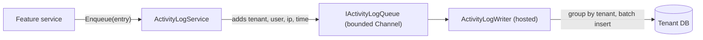

# Activity logs (scalable audit trail)

Original: `reference/backend/School.Infrastructure/Entities/ActivityLog.cs`, `ActivityLogService.cs`,
`ActivityLogsController.cs`, `ActivityLogTypes.cs`; UI `CampusActivityLogsPage.jsx`. The original writes
synchronously inside each request with `int` IDs, offset paging, and no indexes beyond the PK. The blueprint
keeps the **same API shape and explicit call sites** but makes writes non-blocking and reads index-friendly.

---

## 1. Principles

- **Explicit, selective logging.** Services call `IActivityLogService.Enqueue(...)` for business-meaningful
  events (login, create/update/delete, permission changes, settings changes). No blanket middleware that
  logs every HTTP request.
- **Never fail the user's action because logging failed.** Writes are queued and persisted in the background.
- **Append-only.** No updates, no deletes except retention purge.
- **Per tenant.** Each tenant DB has its own `tblActivityLog`; the queue item carries the tenant key.
- **Readable without joins.** Denormalise `Username` and `EntityLabel` at write time.

---

## 2. Table `dbo.tblActivityLog`

| Column | Type | Notes |
|---|---|---|
| `Id` | `bigint` identity | PK, clustered |
| `OccurredAtUtc` | `datetime2(3)` | set when enqueued (not when written) |
| `ActivityType` | `nvarchar(64)` | constant from `ActivityLogTypes` |
| `Module` | `nvarchar(64)` | `Users`, `Auth`, `Settings`… (filter dropdown) |
| `EntityType` | `nvarchar(64)` null | `User`, `SystemSetting`… |
| `EntityId` | `nvarchar(64)` null | string so it works for int/long/guid/composite keys |
| `EntityLabel` | `nvarchar(250)` null | human label at log time ("ali.khan") |
| `UserId` | `int` null | actor; null for system jobs |
| `Username` | `nvarchar(100)` null | denormalised actor name |
| `Summary` | `nvarchar(500)` | one-line plain-language description shown in the list |
| `DetailsJson` | `nvarchar(max)` null | `{ "changes": [{ "field": "Email", "old": "a@x", "new": "b@x" }], "meta": {…} }` |
| `IpAddress` | `varchar(45)` null | |
| `UserAgent` | `nvarchar(300)` null | truncated |
| `CorrelationId` | `varchar(64)` null | `HttpContext.TraceIdentifier` |

Indexes (`ActivityLogConfiguration`):

```csharp
e.ToTable("tblActivityLog", "dbo");
e.HasKey(x => x.Id);
e.HasIndex(x => x.OccurredAtUtc).IsDescending().HasDatabaseName("IX_ActivityLog_OccurredAt");
e.HasIndex(x => new { x.EntityType, x.EntityId, x.OccurredAtUtc }).HasDatabaseName("IX_ActivityLog_Entity");
e.HasIndex(x => new { x.UserId, x.OccurredAtUtc }).HasDatabaseName("IX_ActivityLog_User");
e.HasIndex(x => new { x.ActivityType, x.OccurredAtUtc }).HasDatabaseName("IX_ActivityLog_Type");
```

Volume guidance: this layout handles tens of millions of rows per tenant with keyset paging. For more,
add monthly partitioning on `OccurredAtUtc` or archive to a separate DB — no code change required beyond the
purge job.

---

## 3. Write path



### 3.1 Types (`{Product}.Application/Common/ActivityLogTypes.cs`)

```csharp
public static class ActivityLogTypes
{
    public const string UserLogin = "UserLogin";
    public const string UserLoginAs = "UserLoginAs";
    public const string TenantSwitch = "TenantSwitch";
    public const string PasswordChange = "PasswordChange";
    public const string UserCreate = "UserCreate";
    public const string UserUpdate = "UserUpdate";
    public const string UserDelete = "UserDelete";
    public const string UserPasswordReset = "UserPasswordReset";
    public const string UserPermissionsUpdate = "UserPermissionsUpdate";
    public const string SystemSettingsUpdate = "SystemSettingsUpdate";

    /// <summary>Label + module for UI filters. Add every new type here.</summary>
    public static readonly IReadOnlyDictionary<string, (string Label, string Module)> Catalog =
        new Dictionary<string, (string, string)>
        {
            [UserLogin] = ("Signed in", "Auth"),
            [UserLoginAs] = ("Signed in as another user", "Auth"),
            [TenantSwitch] = ("Switched branch", "Auth"),
            [PasswordChange] = ("Changed password", "Auth"),
            [UserCreate] = ("Added user", "Users"),
            [UserUpdate] = ("Edited user", "Users"),
            [UserDelete] = ("Deleted user", "Users"),
            [UserPasswordReset] = ("Reset password", "Users"),
            [UserPermissionsUpdate] = ("Changed permissions", "Users"),
            [SystemSettingsUpdate] = ("Changed system settings", "Settings"),
        };
}
```

### 3.2 Service API

```csharp
public sealed record ActivityLogEntry(
    string ActivityType,
    string? EntityType = null,
    string? EntityId = null,
    string? EntityLabel = null,
    string? Summary = null,                     // default = Catalog label + EntityLabel
    object? Details = null);                    // serialised to DetailsJson (camelCase)

public interface IActivityLogService
{
    void Enqueue(ActivityLogEntry entry);       // fire-and-forget, never throws
    Task WriteNowAsync(ActivityLogEntry entry, CancellationToken ct = default);   // rare: must be persisted with the transaction
    Task<ActivityLogPageDto> GetAsync(ActivityLogQueryDto query, CancellationToken ct = default);
    IReadOnlyList<ActivityTypeOptionDto> GetTypes();
}
```

`ActivityLogService` (scoped) enriches the entry with `TenantContext.Tenant`, current user (from
`IHttpContextAccessor` claims `UserId`/`Username`), IP, user agent, `TraceIdentifier`, `DateTime.UtcNow`,
then `queue.TryWrite(item)`. If the queue is full it logs a warning and drops (never blocks the request).

Helper for diffs:

```csharp
public static class ActivityDiff
{
    public static List<object> Compare<T>(T before, T after, params string[] fields) { /* field/old/new for changed values */ }
}
```

Never put passwords, hashes, tokens, or connection strings in `DetailsJson`.

### 3.3 Queue + writer (API layer, singletons)

```csharp
public interface IActivityLogQueue { bool TryWrite(QueuedActivityLog item); ChannelReader<QueuedActivityLog> Reader { get; } }

public sealed class ActivityLogQueue(IConfiguration cfg) : IActivityLogQueue
{
    private readonly Channel<QueuedActivityLog> _channel = Channel.CreateBounded<QueuedActivityLog>(
        new BoundedChannelOptions(cfg.GetValue("ActivityLog:QueueCapacity", 10_000))
        { FullMode = BoundedChannelFullMode.DropWrite, SingleReader = true });
    public bool TryWrite(QueuedActivityLog item) => _channel.Writer.TryWrite(item);
    public ChannelReader<QueuedActivityLog> Reader => _channel.Reader;
}
```

`ActivityLogWriter : BackgroundService`:

1. `await reader.WaitToReadAsync(ct)`; drain up to `ActivityLog:BatchSize` items (or 1 s window).
2. Group by `Tenant`; for each group resolve the connection with `ITenantRegistry.Find(key)`, create a context
   with `TenantDbContextFactory.Create(...)`, `AddRange`, `SaveChangesAsync`.
3. On failure: retry once after 2 s, then log the error with the item count (do not crash the service).
4. On shutdown (`StopAsync`) flush remaining items.

`ActivityLogPurgeService : BackgroundService` — once per day, for each active tenant:
`DELETE TOP (5000) FROM dbo.tblActivityLog WHERE OccurredAtUtc < @cutoff` in a loop until 0 rows
(`ExecuteDeleteAsync` with `Take` is fine). `ActivityLog:RetentionDays` (0 = keep forever).

---

## 4. Read API

`GET api/activity-logs` (`[RequirePermission(PermissionCodes.ActivityLogView)]`)

| Query | Notes |
|---|---|
| `from`, `to` | dates (tenant-local day boundaries converted to UTC) |
| `userId` | actor |
| `module`, `activityType` | from `GetTypes()` |
| `entityType`, `entityId` | "history of this record" views |
| `search` | `Summary`/`EntityLabel`/`Username` `LIKE` prefix |
| `beforeId` | **keyset cursor** — return rows with `Id < beforeId` |
| `pageSize` | default 50, max 200 |

Response:

```json
{
  "success": true,
  "data": {
    "items": [{ "id": 981, "occurredAtUtc": "…", "activityType": "UserUpdate", "activityLabel": "Edited user",
                "module": "Users", "entityType": "User", "entityId": "12", "entityLabel": "ali.khan",
                "userId": 1, "username": "admin", "summary": "Edited user ali.khan", "details": { … } }],
    "nextBeforeId": 931,
    "hasMore": true
  }
}
```

Order: `ORDER BY Id DESC` (identity order = time order). No `COUNT(*)` on the main query (expensive at scale);
the UI shows "Load more" instead of page numbers.

`GET api/activity-logs/types` → `[{ value, label, module }]` for filter dropdowns.
`GET api/activity-logs/entity/{entityType}/{entityId}` → same shape, for record history tabs.

---

## 5. UI (`pages/App/activity-logs/ActivityLogsPage.jsx`)

Port the look of `reference/frontend/src/pages/Campus/activity-logs/CampusActivityLogsPage.jsx`:

- Header card per CRUD rules (icon `History`, title "Activity Logs").
- Filter bar: date range (default last 7 days), Module, Activity, User (searchable select), search box,
  Reset.
- Dense table: Time (tenant-local, `dd MMM yyyy, hh:mm a`), User, Activity (pill coloured by module),
  Record (`entityLabel`), Summary, details chevron.
- Row click → **off-canvas drawer** (`Drawer` md) with a field/old/new table from `details.changes` and the
  metadata (IP, browser).
- "Load more" button at the bottom using `nextBeforeId`; filters in URL query.
- `activityLogService.js`: `getActivityLogs(params)`, `getActivityTypes()`, `getEntityHistory(type, id)`.

Dashboard "Recent activity" uses `GET api/activity-logs?pageSize=8` (or `api/dashboard/summary`).

---

## 6. Adding logging to a new feature

1. Add constants + catalog entry in `ActivityLogTypes`.
2. In the service after a successful save:
   ```csharp
   _activityLog.Enqueue(new ActivityLogEntry(ActivityLogTypes.ProductCreate, "Product",
       product.Id.ToString(), product.Name, Details: new { changes = ActivityDiff.Compare(before, product, "Name", "Price") }));
   ```
3. Nothing else — UI filters pick it up from `GET api/activity-logs/types`.
